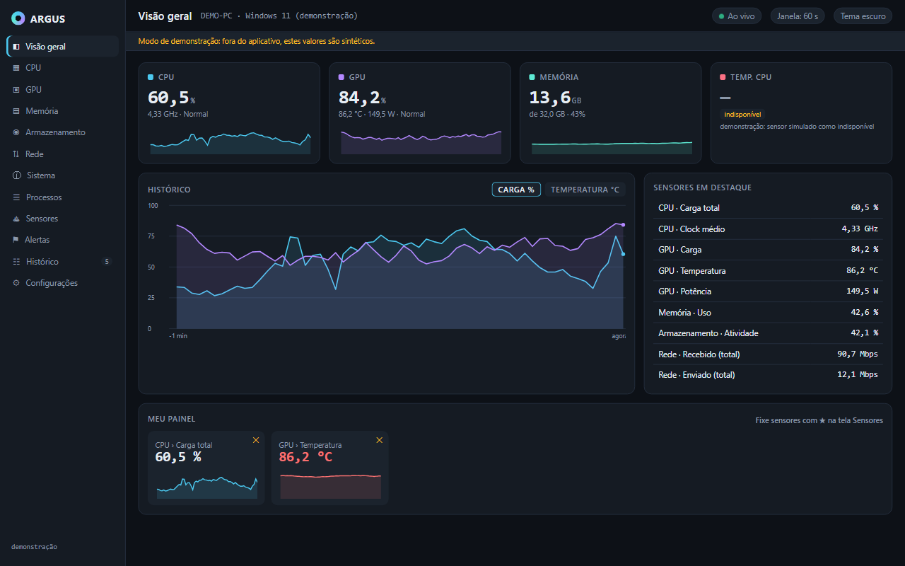
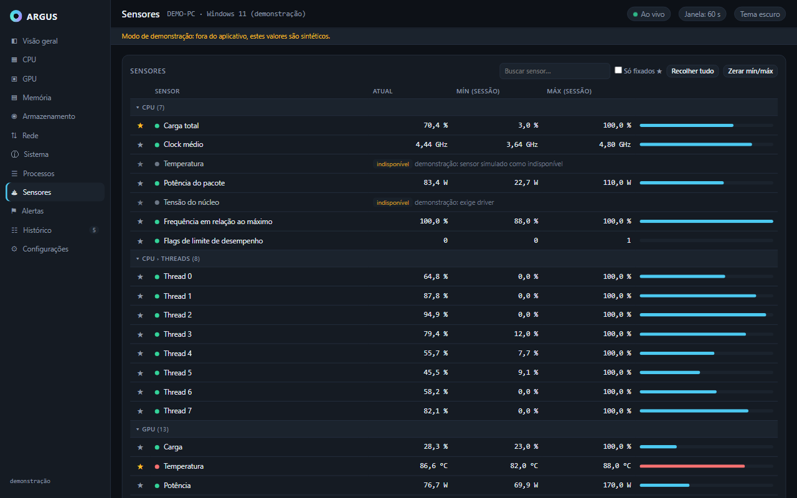

# Argus

Argus is a hardware monitor for Windows, built with Rust and Tauri. It shows live
CPU, GPU, memory, disk and network readings, with charts and configurable alerts.
The interface is currently in Brazilian Portuguese.



*Overview in browser demonstration mode. These readings are synthetic; the desktop
app collects data from your hardware.*

## What it does

- Tracks sensor values, charts, and session minimums and maximums. Pin sensors to
  your overview and switch between 60-second, 5-minute and 15-minute chart windows.
- Shows CPU details and per-thread load, GPU readings, memory modules, storage
  health where available, network adapters, motherboard/BIOS details and processes.
- Evaluates alert rules with thresholds and time windows. Alerts can show a toast,
  play a sound or send a Windows notification. Presets help set up initial rules.
- Saves settings and alert rules locally. Alert history has filters, retention
  settings and CSV export; sensor history from the current session can also be exported.
- Keeps collecting and evaluating alerts in the system tray. Pausing the view
  freezes the display while collection continues.



*Sensors in browser demonstration mode. Missing readings show a reason instead of zero.*

## Hardware support and limits

Argus targets Windows 10/11 on x64. Native verification so far covers a Windows 11
machine with a Ryzen 5 3500X, an NVIDIA GPU and NVMe storage. Other hardware has
not been verified to the same extent. There are no native Linux or macOS collectors.

Most readings use Windows APIs without elevation. NVIDIA metrics use NVML from
the installed NVIDIA driver. Other GPUs use generic Windows counters where
available. SMART data, memory timings, fan readings and some CPU/GPU fields depend
on what the hardware and its interfaces expose. Unsupported values stay
unavailable with an explanation.

CPU temperature, physical Vcore and the package-power fallback use an optional
CPU-only helper with LibreHardwareMonitor and the signed PawnIO driver. Opening
Argus does not require administrator rights; activating this backend requests
Windows administrator consent. Existing Windows package-power readings remain
the first source. See the [CPU backend documentation](tools/cpu-temperature/README.md).

## Run from source

For native development, install:

- Rust stable with the `x86_64-pc-windows-msvc` toolchain.
- Visual Studio Build Tools with **Desktop development with C++** and a Windows SDK.
- Microsoft Edge WebView2 Runtime.
- Windows PowerShell 5.1 and .NET Framework 4.7.2 or later, including its Framework64
  C# compiler, for the CPU helper. A separate .NET SDK is not required.
- Tauri CLI 2.x for the desktop commands below. Node.js is only needed for the
  browser demo and UI tests; these were checked with Node 24.

The [Tauri Windows prerequisites](https://v2.tauri.app/start/prerequisites/#windows)
cover the native build tools and WebView2 setup. From PowerShell:

```powershell
git clone https://github.com/jordyfontoura/argus.git
cd argus
cargo fetch
cargo install tauri-cli --version "^2" --locked
```

Open the desktop app:

```powershell
cargo tauri dev
```

The frontend is plain HTML, CSS and JavaScript in `ui/`. There is no `npm install`
or frontend bundling step. Cargo also builds the C# helper. The first native build
downloads hash-pinned NuGet packages and the official PawnIO installer; later
builds use the verified cache under `target/`. Building does not activate the
helper or install the driver.

For a release-mode executable without generating an installer:

```powershell
cargo tauri build --no-bundle
```

The executable is `target/release/argus-app.exe`. This is a local build, not a
standalone distribution package; optional CPU readings require the activated helper.

Inspect live readings without opening the GUI:

```powershell
cargo run -p argus-probe -- snapshot --json
```

The snapshot contains sensor identifiers, units, timestamps and reading status.
Additional CLI commands are described in [CONTRIBUTING.md](CONTRIBUTING.md).

## Try the interface in a browser

With Node.js installed, run:

```powershell
node tools/serve-ui.mjs
```

Open <http://127.0.0.1:4173>. This serves the same interface with synthetic data
and a visible demonstration banner. It does not read your hardware or exercise
native notifications, driver activation or persistence. The README screenshots
were captured this way to keep machine identifiers out of the images.

## Project status

The current version is 0.2.0. The source is licensed under MIT, but the current
unsigned installer is not ready for public binary distribution. CPU-backend
activation elevates PowerShell scripts from a user-writable bundle. File hashes
detect corruption; they do not authenticate a bundle replaced together with its
manifest. A separately trusted activation bootstrap and a new review are required
before distributing installers to other users or machines. See
[SECURITY.md](SECURITY.md) for the current trust boundary.

## Contribute

Read [CONTRIBUTING.md](CONTRIBUTING.md) for setup, checks and hardware bug reports.
Use [GitHub issues](https://github.com/jordyfontoura/argus/issues) for bugs and feature
requests. Read [SECURITY.md](SECURITY.md) before reporting a vulnerability.

The Rust workspace lives in `crates/` and `src-tauri/`; the frontend is in `ui/`.
The repository contains the source, tests and build tools needed for contribution.

## License

Argus's own code is licensed under [MIT](LICENSE). Dependencies keep their own
licenses. The CPU bundle includes MPL, Apache, MIT and LGPL components, and the
official PawnIO installer has separate binary redistribution terms. See the
[third-party notices](tools/cpu-temperature/THIRD-PARTY-NOTICES.txt) and
[license texts](tools/cpu-temperature/licenses/). The root MIT license does not
relicense those components.
